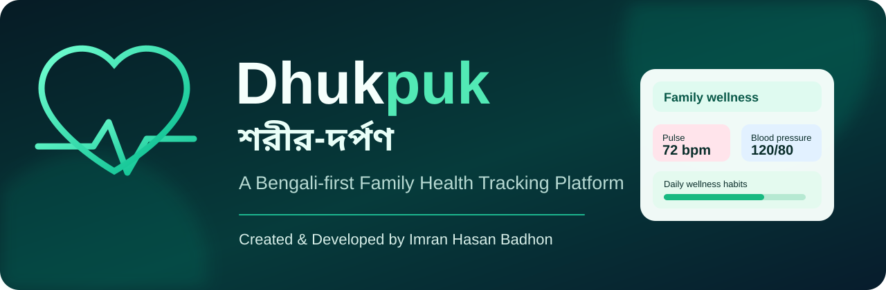

# Dhukpuk — শরীর-দর্পণ

<p align="center">
  
</p>

A Bengali-first family wellness and health-record tracking web app.

**Created & Developed by Imran Hasan Badhon**

- Live app: https://dhukpuk-sreer-drpn.hatchable.site
- GitHub: https://github.com/imranbrand/dhukpuk-health-tracker

## Features

- Bengali-first responsive dashboard
- Multiple family member profiles
- Manually entered health readings: weight, blood pressure (SYS/DIA), pulse, SpO₂ and blood glucose
- Wellness habit tracking: steps, water and sleep
- BMI estimate when both weight and profile height are available
- Recent reading history
- Habit score calculated only from steps, water and sleep
- Share habit score using Web Share API, with clipboard fallback

## Run locally

This is a static front-end project. No build step or package installation is required.

1. Clone the repository:
   ```bash
   git clone https://github.com/imranbrand/dhukpuk-health-tracker.git
   cd dhukpuk-health-tracker
   ```
2. Serve the `public` directory with any static HTTP server. For example, with Python:
   ```bash
   python -m http.server 8000 --directory public
   ```
3. Open http://localhost:8000

You can also open `public/index.html` directly, although using a local HTTP server is recommended.

## Data and privacy

- Current records are stored in the browser's Local Storage on the device and browser where they were entered.
- There is currently no account system, cloud database, automatic backup, or cross-device synchronization.
- Clearing browser data may delete locally stored records. Export/backup is not currently implemented.
- Do not use this app as the only place to store important medical records.

## Medical safety notice

Dhukpuk is a personal tracking and wellness-record tool, **not a medical device and not a diagnostic service**. It does not diagnose, treat, or prevent disease. It does not measure blood pressure or oxygen saturation using a phone camera. Enter readings obtained from appropriate measurement devices. Do not make medical decisions based on the app's habit score or display alone; consult a qualified healthcare professional for symptoms, unusual readings, or urgent concerns.

## Technology

- HTML5
- CSS3
- Vanilla JavaScript
- Browser Local Storage
- Google Fonts (Noto Sans Bengali and DM Sans, with fallback fonts)

## Project structure

```text
.
├── hatchable.toml
├── README.md
└── public
    ├── app.js
    ├── index.html
    └── style.css
```

## Roadmap

Potential future work includes secure backup/export, optional authentication, cloud synchronization, accessibility improvements, and automated tests. These are not implemented in the current version.
